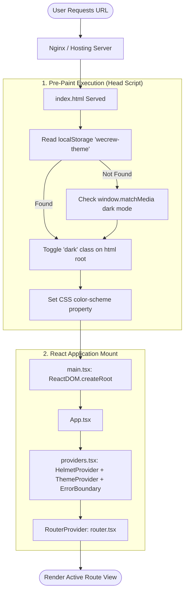
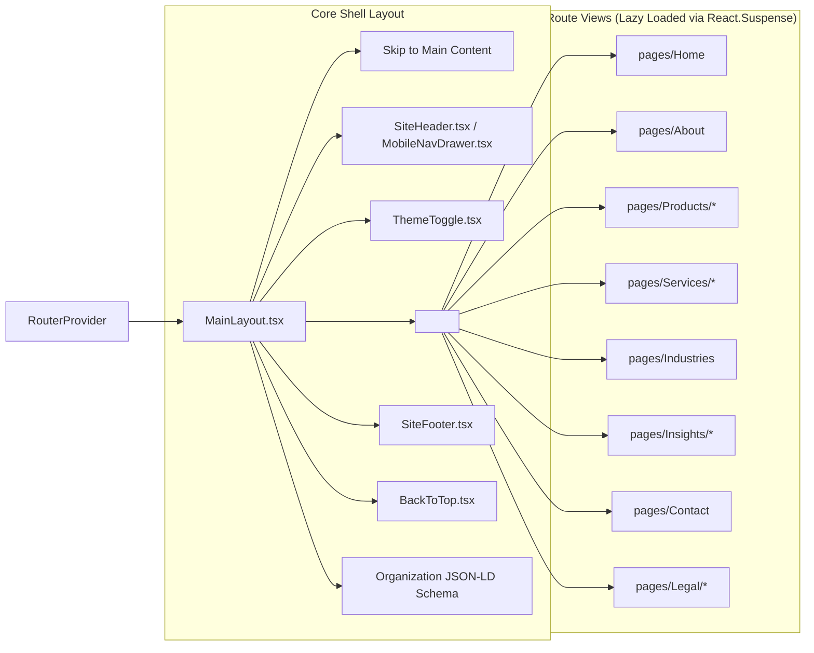
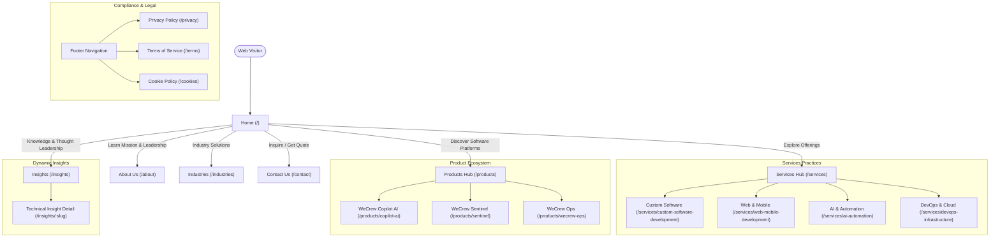
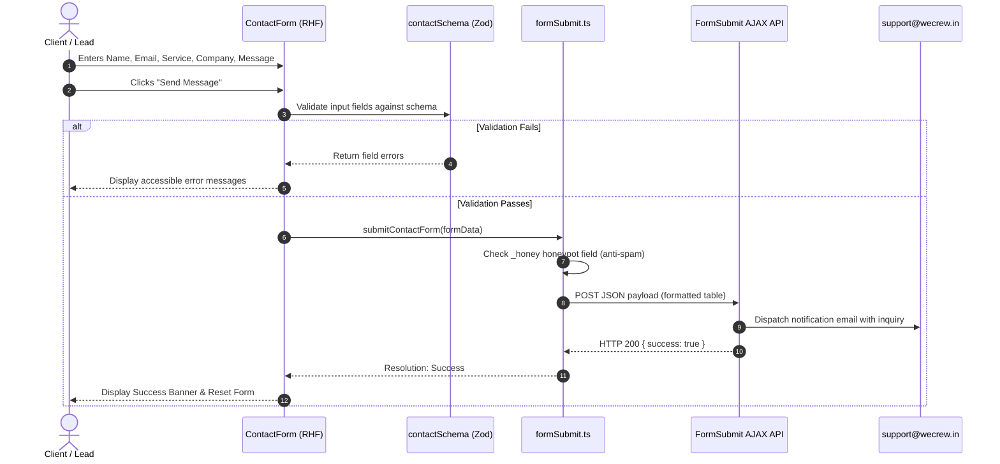
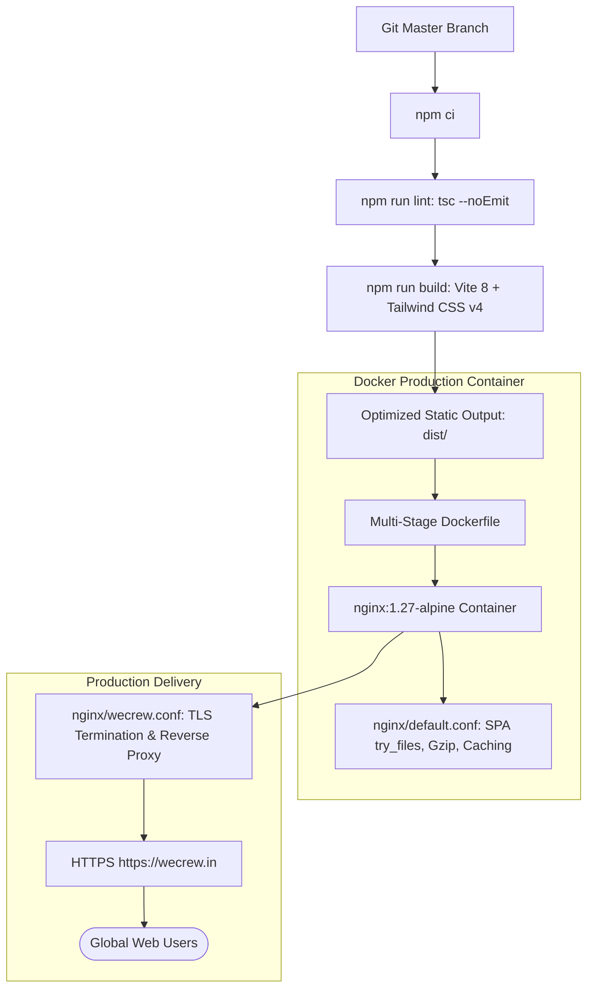

<div align="center">

# WeCrew Technologies Private Limited
### Enterprise Corporate Website — React + Vite Architecture

[](https://react.dev/)
[](https://vitejs.dev/)
[](https://www.typescriptlang.org/)
[](https://tailwindcss.com/)
[](https://reactrouter.com/)
[](https://www.docker.com/)
[](https://nginx.org/)

**Official Corporate Portal:** [https://wecrew.in](https://wecrew.in)

</div>

---

## Executive Overview

This repository contains the complete production-grade source code for the **WeCrew Technologies Private Limited** corporate platform. The application is engineered as a high-performance **React 19 + Vite 8 + TypeScript** Single Page Application (SPA), delivering enterprise reliability, zero-flash theme synchronization, instant client transitions, and clean maintainability.

### Key Highlights
- ⚡ **Ultra-Fast Bundling:** Optimized Vite production build completes in **~3.8s** (`tsc -b && vite build`)
- 📦 **Granular Code Splitting:** Automatic vendor chunking and on-demand route chunks (<15 kB gzipped per route)
- 🌓 **Zero-FOUC Theme Engine:** Pre-paint theme resolution script in `index.html` preventing theme flash
- 📬 **Serverless Inquiries:** Secure direct email delivery to `support@wecrew.in` via FormSubmit AJAX with client-side Zod validation
- 🛡️ **Containerized Production:** Multi-stage Alpine Docker + Nginx with SPA fallback routing, security headers, and immutable asset caching

---

## Table of Contents

1. [Project Flows & Architecture](#1-project-flows--architecture)
   - [A. Application Bootstrap & Pre-Paint Flow](#a-application-bootstrap--pre-paint-flow)
   - [B. Runtime Component & Layout Flow](#b-runtime-component--layout-flow)
   - [C. User Journey & Navigation Routing Flow](#c-user-journey--navigation-routing-flow)
   - [D. Contact Form & Lead Pipeline Flow](#d-contact-form--lead-pipeline-flow)
   - [E. Production Build & Deployment Flow](#e-production-build--deployment-flow)
2. [Technology Stack](#2-technology-stack)
3. [Project Directory Structure](#3-project-directory-structure)
4. [Route Inventory & Navigation Map](#4-route-inventory--navigation-map)
5. [Theme Engine (Light / Dark / System)](#5-theme-engine-light--dark--system)
6. [Contact Form & FormSubmit Integration](#6-contact-form--formsubmit-integration)
7. [Local Development & Verification](#7-local-development--verification)
8. [Production Deployment Guide](#8-production-deployment-guide)
9. [Corporate Information](#9-corporate-information)

---

## 1. Project Flows & Architecture

### A. Application Bootstrap & Pre-Paint Flow

The application executes a pre-paint theme script before React mounts to eliminate any Flash of Unstyled Content (FOUC).



---

### B. Runtime Component & Layout Flow

All route pages are wrapped inside `MainLayout`, providing unified branding, sticky navigation, breadcrumbs, smooth scroll restoration, and JSON-LD schema metadata.



---

### C. User Journey & Navigation Routing Flow



---

### D. Contact Form & Lead Pipeline Flow

Inquiries submitted through the contact page undergo client-side validation, anti-spam honeypot filtering, and automated serverless transmission directly to the corporate support inbox.



---

### E. Production Build & Deployment Flow



---

## 2. Technology Stack

| Layer | Technology | Version | Purpose |
| :--- | :--- | :--- | :--- |
| **UI Framework** | React | `19.1.0` | Declarative UI rendering & state management |
| **Bundler & Tooling** | Vite | `8.3.8` | Ultra-fast HMR and optimized production bundling |
| **Language** | TypeScript | `5.7.0` | Strict end-to-end type safety |
| **Client Routing** | React Router DOM | `7.18.5` | Centralized SPA routing, nested layouts, lazy loading |
| **Styling Engine** | Tailwind CSS | `4.3.5` | Semantic theme tokens, `@theme inline`, modern utility styles |
| **Form Management** | React Hook Form | `7.92.0` | Performant uncontrolled form state management |
| **Schema Validation**| Zod | `4.6.7` | Type-safe runtime input validation |
| **Email Service** | FormSubmit AJAX | API v1 | Serverless inquiry delivery to `support@wecrew.in` |
| **SEO & Head** | React Helmet Async | `3.1.0` | Dynamic titles, meta tags, and Open Graph cards |
| **Iconography** | Lucide React | `0.545.0` | Accessible, tree-shakeable SVG icons |
| **Production Server** | Nginx | `1.27-alpine`| Reverse proxy, SPA fallback, Gzip, security headers |

---

## 3. Project Directory Structure

```
wecrew-website/
├── public/                         # Static assets served at domain root
│   ├── wecrew-logo-512.png         # WeCrew 512px logo mark (used in navigation & branding)
│   ├── wecrew-logo.png             # High-resolution master logo mark
│   ├── raj-kumar-founder.png       # Founder portrait
│   ├── icon.png                    # Brand favicon
│   ├── apple-icon.png              # Apple touch icon
│   ├── robots.txt                  # Search crawler access directives
│   └── sitemap.xml                 # Canonical XML sitemap
│
├── src/
│   ├── app/                        # Core application wiring
│   │   ├── App.tsx                 # Root layout & providers wrapper
│   │   ├── router.tsx              # Centralized React Router configuration
│   │   └── providers.tsx           # Helmet, Theme & ErrorBoundary providers
│   │
│   ├── components/                 # Reusable UI component primitives
│   │   ├── about/                  # About page components (Founder portrait, principles)
│   │   ├── animations/
│   │   │   └── Reveal.tsx          # IntersectionObserver scroll reveal component
│   │   ├── common/
│   │   │   ├── ErrorBoundary.tsx   # Catch-all runtime error boundary
│   │   │   ├── Image.tsx           # Accessible image component with dimension constraints
│   │   │   └── LoadingFallback.tsx # Branded spinner for route transitions
│   │   ├── forms/
│   │   │   └── ContactForm.tsx     # RHF + Zod + FormSubmit contact form
│   │   ├── layout/
│   │   │   ├── SiteHeader.tsx      # Responsive sticky navigation & mobile drawer
│   │   │   └── SiteFooter.tsx      # Corporate footer with route & legal links
│   │   ├── navigation/
│   │   │   ├── BackToTop.tsx       # Smooth scroll-to-top floating button
│   │   │   ├── Logo.tsx            # Branded logo component
│   │   │   └── MobileNavDrawer.tsx # Mobile drawer navigation
│   │   ├── services/               # Services cards, processes & technology grids
│   │   ├── theme/
│   │   │   └── ThemeToggle.tsx     # Tri-state theme toggle (Sun/Moon/System)
│   │   └── ui/
│   │       ├── Modal.tsx           # Accessible modal dialog primitive (WCAG 2.2 AA)
│   │       ├── Tooltip.tsx         # Accessible tooltip wrapper
│   │       └── index.tsx           # Buttons, section headings, breadcrumbs, check items
│   │
│   ├── constants/                  # Typed domain models & static content
│   │   ├── site.ts                 # Site metadata, addresses, contacts, social links
│   │   ├── services.ts             # Service offerings, deliverables, methodology
│   │   ├── products.ts             # Product ecosystem definitions
│   │   ├── industries.ts           # Industry vertical domain copy
│   │   ├── technologies.ts         # Technology stack matrix
│   │   └── insights.ts             # Technical articles and blog posts
│   │
│   ├── contexts/
│   │   └── ThemeContext.tsx        # Zero-flash tri-state theme state provider
│   ├── hooks/
│   │   └── useTheme.ts             # Theme consumer hook
│   │
│   ├── layouts/
│   │   └── MainLayout.tsx          # Shell with Header, Footer, JSON-LD, & ScrollRestoration
│   │
│   ├── pages/                      # Route-level views (code-split)
│   │   ├── Home/                   # Hero, showcase, stats, and feature sections
│   │   ├── About/                  # Corporate mission, values, and leadership profile
│   │   ├── Products/               # Products overview, Copilot AI, Sentinel, Wecrew Ops
│   │   ├── Services/               # Services catalog and dynamic practice pages
│   │   ├── Industries/             # Industry verticals showcase
│   │   ├── Insights/               # Tech insights hub and dynamic detail views
│   │   ├── Contact/                # Interactive contact inquiry page
│   │   ├── Legal/                  # Privacy Policy, Terms of Service, Cookie Policy
│   │   └── NotFound/               # Branded 404 recovery page
│   │
│   ├── schemas/
│   │   └── contactSchema.ts        # Zod validation schema for contact inquiries
│   ├── services/
│   │   └── formSubmit.ts           # FormSubmit AJAX HTTP delivery service
│   ├── styles/
│   │   └── globals.css             # Tailwind v4 theme tokens, CSS variables, typography
│   └── main.tsx                    # Client entry point
│
├── nginx/
│   ├── default.conf                # Container web server configuration (SPA routing)
│   └── wecrew.conf                 # TLS-terminating reverse proxy
│
├── .env.example                    # Environment variable template
├── .gitignore                      # Git ignore rules (builds, logs, temp data)
├── Dockerfile                      # Multi-stage production container build
├── docker-compose.yml              # Container composition definition
├── index.html                      # HTML entry point with pre-paint theme script
├── package.json                    # Project dependencies and script definitions
├── tsconfig.json                   # TypeScript path alias configuration (@/*)
└── vite.config.ts                  # Vite plugins, manualChunks, and preview config
```

---

## 4. Route Inventory & Navigation Map

The application provides 22 canonical URLs with instant client-side transitions and route-level code splitting:

| Route Path | View / Component | Page Purpose | Chunk Loading |
| :--- | :--- | :--- | :--- |
| `/` | `pages/Home` | Corporate Homepage & Hero | Dynamic Import |
| `/about` | `pages/About` | Company Overview, Leadership & Values | Dynamic Import |
| `/products` | `pages/Products` | Products Ecosystem Overview | Dynamic Import |
| `/products/copilot-ai` | `pages/Products/CopilotAI` | WeCrew Copilot AI Enterprise RAG | Dynamic Import |
| `/products/sentinel` | `pages/Products/Sentinel` | WeCrew Sentinel API Security | Dynamic Import |
| `/products/wecrew-ops` | `pages/Products/WecrewOps` | WeCrew Ops Cloud Operations Suite | Dynamic Import |
| `/products/ops` | Redirect | Aliased redirect to `/products/wecrew-ops` | Instant Redirect |
| `/services` | `pages/Services` | Solutions & Practices Hub | Dynamic Import |
| `/services/custom-software-development` | `pages/Services/ServiceRoute` | Custom Enterprise Software | Dynamic Import |
| `/services/web-mobile-development` | `pages/Services/ServiceRoute` | Web & Mobile Engineering | Dynamic Import |
| `/services/ai-automation` | `pages/Services/ServiceRoute` | Intelligent Automation & ML | Dynamic Import |
| `/services/devops-infrastructure` | `pages/Services/ServiceRoute` | DevOps, Cloud & SRE | Dynamic Import |
| `/services/:slug` | `pages/Services/ServiceRoute` | Generic Dynamic Service Route | Dynamic Import |
| `/industries` | `pages/Industries` | Industry Solutions Showcase | Dynamic Import |
| `/insights` | `pages/Insights` | Technology Insights Hub | Dynamic Import |
| `/insights/:slug` | `pages/Insights/InsightDetail` | Dynamic Technical Articles | Dynamic Import |
| `/contact` | `pages/Contact` | Contact Form & Headquarters | Dynamic Import |
| `/privacy` | `pages/Legal/Privacy` | Privacy Policy | Dynamic Import |
| `/terms` | `pages/Legal/Terms` | Terms of Service | Dynamic Import |
| `/cookies` | `pages/Legal/Cookies` | Cookie Policy | Dynamic Import |
| `/404` | `pages/NotFound` | Branded 404 Recovery Page | Dynamic Import |
| `/*` | `pages/NotFound` | Catch-all 404 Recovery Page | Dynamic Import |

### External Live Product Portals
- **WeCrew Copilot AI:** [https://kt.copilot.wecrew.in](https://kt.copilot.wecrew.in)
- **WeCrew Sentinel:** [https://sentinel.wecrew.in/](https://sentinel.wecrew.in/)

---

## 5. Theme Engine (Light / Dark / System)

The theme system provides a seamless visual experience without any flash of unstyled content (FOUC):

### Implementation Mechanics
1. **Pre-Paint Script:** An inline script in `index.html` resolves the stored theme preference from `localStorage.getItem('wecrew-theme')` or falls back to `window.matchMedia('(prefers-color-scheme: dark)')` before the browser executes its first paint.
2. **Tri-State Cycle:** The header theme toggle button smoothly cycles through `System` (default) $\rightarrow$ `Light` $\rightarrow$ `Dark` $\rightarrow$ `System`.
3. **Semantic CSS Variables:** Defined in `src/styles/globals.css`:
   - `:root`: Light mode base tokens (`--bg-base`, `--ink-primary`, `--line-border`).
   - `.dark`: Dark mode tokens (`--bg-base: #030712`, `--ink-primary: #f9fafb`).
   - Mapped into Tailwind CSS v4 via `@theme inline`, enabling utilities such as `bg-base`, `text-ink`, `border-line` to adapt automatically.
4. **OS Sync:** When set to `System`, the application actively listens for changes in OS dark mode preferences and adapts in real-time.

---

## 6. Contact Form & FormSubmit Integration

The contact form is powered by **FormSubmit AJAX**, sending inquiries directly to **`support@wecrew.in`** without requiring a dedicated backend server or SMTP credential management.

### Form Fields & Client-Side Validation Rules
| Field | Type | Validation Rule |
| :--- | :--- | :--- |
| **Full Name** | Text | Required; minimum 2 characters |
| **Business Email** | Email | Required; valid corporate email address format |
| **Phone Number** | Tel | Required; minimum 7 characters |
| **Company Name** | Text | Required; minimum 2 characters |
| **Service Interested In** | Select | Required; must choose from active service practices |
| **Project Description** | Textarea | Required; minimum 20 characters |
| **Project Budget** | Select | Optional range selection |
| **Additional Information**| Textarea | Optional comments or timeline notes |
| **Honeypot (`_honey`)** | Hidden Text | Anti-spam field; silently ignores automated bot submissions |
| **Privacy Policy** | Checkbox | Required; must agree to privacy policy |

### Mandatory One-Time Form Activation
> [!IMPORTANT]
> **Activation Protocol for `support@wecrew.in`:**
> 1. When the first contact form inquiry is sent from the website, FormSubmit will dispatch a confirmation email to **`support@wecrew.in`**.
> 2. Open `support@wecrew.in` and click the **"Activate Form"** button inside the FormSubmit message.
> 3. After this one-time activation, all subsequent inquiries will deliver directly to the inbox without captchas or confirmation requests.

---

## 7. Local Development & Verification

### Prerequisites
- Node.js `20.x` or `22.x` (LTS recommended)
- npm `10.x` or higher

### Commands
```bash
# 1. Install dependencies
npm install

# 2. Start local development server with instant HMR (http://localhost:3000)
npm run dev

# 3. Perform strict TypeScript type checking across all files
npm run lint

# 4. Compile optimized production distribution bundle
npm run build

# 5. Serve local preview of the production build
npm run preview
```

---

## 8. Production Deployment Guide

### Option A: Multi-Stage Docker (Recommended)

The included `Dockerfile` builds the application with `node:22-alpine` and serves it via an ultra-lightweight `nginx:1.27-alpine` container:

```bash
# Build and start container in detached mode
docker compose up -d --build

# Inspect running container
docker compose ps

# View container output logs
docker compose logs -f
```

The container configuration provides:
- Automatic SPA fallback (`try_files $uri $uri/ /index.html;`)
- Gzip compression for HTML, CSS, JS, SVG, and JSON
- 1-year immutable caching for `/assets/`
- Zero-cache directives for `index.html` to guarantee instant deployment updates
- Enterprise security headers: `X-Frame-Options: SAMEORIGIN`, `X-Content-Type-Options: nosniff`, `Referrer-Policy: strict-origin-when-cross-origin`

### Option B: Nginx on Linux VPS / VM

1. Build the production bundle:
   ```bash
   npm ci
   npm run build
   ```
2. Copy `dist/` to the target server web root:
   ```bash
   sudo mkdir -p /var/www/wecrew
   sudo cp -r dist/* /var/www/wecrew/
   sudo chown -R www-data:www-data /var/www/wecrew
   ```
3. Use the supplied Nginx configuration from `nginx/default.conf` and `nginx/wecrew.conf`.
4. Enable the site and configure SSL with Let's Encrypt / Certbot:
   ```bash
   sudo certbot --nginx -d wecrew.in -d www.wecrew.in
   ```

### Option C: Cloudflare Pages / Vercel / Netlify / AWS S3 + CloudFront

Because the application compiles to 100% static assets:
- **Build Command:** `npm run build`
- **Output Directory:** `dist`
- **SPA Rewrites:** Configure rewrite rule: `/*` $\rightarrow$ `/index.html` (HTTP 200).

---

## 9. Corporate Information

**WeCrew Technologies Private Limited**
- **Website:** [https://wecrew.in](https://wecrew.in)
- **Support Inquiries:** [support@wecrew.in](mailto:support@wecrew.in)
- **Products:**
  - **WeCrew Copilot AI:** [https://kt.copilot.wecrew.in](https://kt.copilot.wecrew.in)
  - **WeCrew Sentinel:** [https://sentinel.wecrew.in/](https://sentinel.wecrew.in/)

---

<div align="center">
  <sub>© 2026 WeCrew Technologies Private Limited. All rights reserved.</sub>
</div>